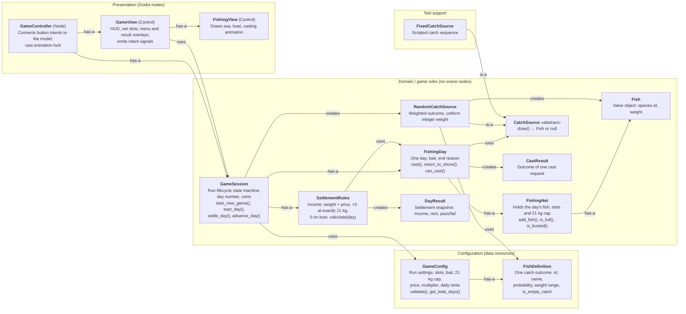

# Class Map — Stage 1 (`stage-1`)

Drawn from the code at the [`stage-1` tag](https://github.com/Peggyyyyyyyy123/fishing-21/tree/stage-1). The tag itself is frozen, so this map was added afterwards on the Stage 2 branch. It describes Stage 1 code only.

Connector labels: **is-a** (inheritance), **has-a** (owns a long-lived part), **uses** (calls or reads it while working), **creates** (constructs instances). Formal UML notation is not used.

## Classes and responsibilities

| Layer | Class | Main responsibility | Key attributes / methods |
| --- | --- | --- | --- |
| Config | `GameConfig` | All tunable numbers for one run; validation | `net_slots`, `bait_per_day`, `weight_cap_kg`, `price_per_kg`, `perfect_multiplier`, `daily_quotas`, `fish_definitions`, `validate()` |
| Config | `FishDefinition` | Data for one catch outcome, so a new fish size is data, not a subclass | `species_id`, `probability`, `min_weight_kg`, `max_weight_kg`, `is_empty_catch` |
| Domain | `GameSession` | Seven-day run: states, day advance, paying coins once per settled day | `State` enum, `start_day()`, `settle_day()`, `advance_day()` |
| Domain | `FishingDay` | One day's casting, bait and end conditions (bust > full net > no bait) | `cast()`, `return_to_shore()`, `get_end_reason()` |
| Domain | `FishingNet` | Stores catches; reports full and busted | `add_fish()`, `get_total_weight_kg()` |
| Domain | `Fish` | Immutable catch value | `species_id`, `weight_kg` |
| Domain | `CatchSource` | Abstract source of catches; lets tests replace randomness | `draw()` |
| Domain | `RandomCatchSource` | Normal gameplay draws | weighted pick, uniform weight |
| Domain | `CastResult` | REJECTED / EMPTY / CAUGHT / SOURCE_ERROR for the UI | `get_status()`, `get_fish()` |
| Domain | `SettlementRules` | Computes income without paying it | `calculate(day)` |
| Domain | `DayResult` | Immutable settlement result | `is_passed()`, `get_coin_gain()` |
| Presentation | `GameController` | Input → model calls; locks input during casting | signal handlers, `catch_source_factory` |
| Presentation | `GameView` | Displays snapshots; emits `cast_requested`, etc. | `render()`, `show_result()` |
| Presentation | `FishingView` | Scenery drawing only | `set_casting()` |
| Test | `FixedCatchSource` | Reproducible catches for tests and demos | sequence of `Fish` |

## Core vs presentation

The domain classes extend `RefCounted` and never reference buttons or scene nodes. The presentation classes read snapshots and call domain methods. `GameController.catch_source_factory` and `GameSession.start_day(source)` let a test or live demonstration inject a fixed catch sequence without changing rules.
