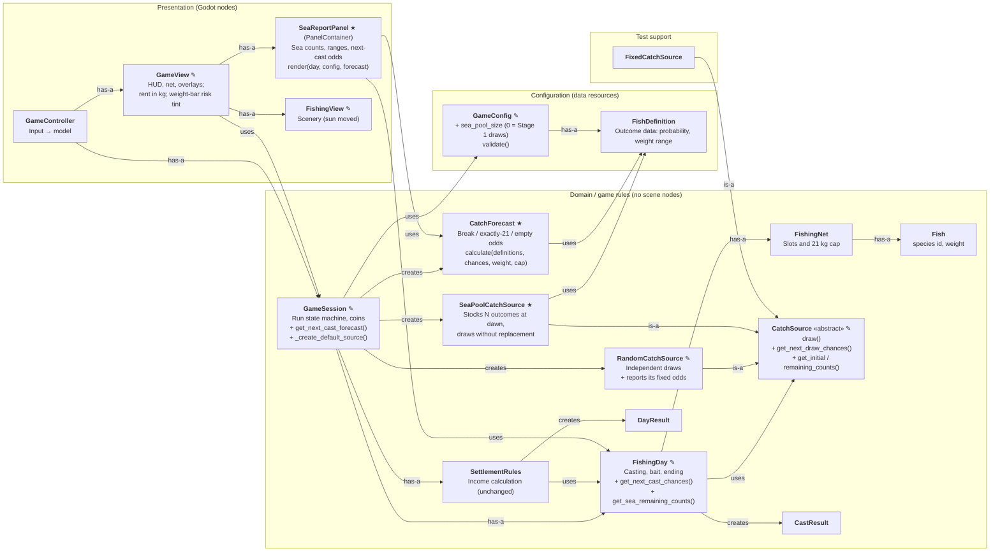

# Class Map — Stage 2 (`stage-2`)

Stage 2 adds a visible, finite daily sea and next-cast odds. **New** classes are marked ★, **modified** classes are marked ✎, and the rest are unchanged from [Stage 1](class_map_stage_1.md).

Connector labels: **is-a**, **has-a**, **uses**, **creates**.

## New and changed responsibilities

| Class | Status | Responsibility in Stage 2 |
| --- | --- | --- |
| `SeaPoolCatchSource` | New | A finite sea for one day: random stocking from the configured distribution, draws without replacement, public counts |
| `CatchForecast` | New | Pure calculation of next-cast odds from outcome chances and weight ranges. No state, no engine types |
| `SeaReportPanel` | New | Draws the sea report and odds; owns the risk colour thresholds |
| `CatchSource` | Modified | Added three read-only queries with safe defaults (`{}` = unknown), so `FixedCatchSource` needed no change |
| `RandomCatchSource` | Modified | Reports its fixed odds, so the forecast also works with `sea_pool_size = 0` |
| `FishingDay` | Modified | Passes source queries through to the UI. Casting and ending rules unchanged |
| `GameSession` | Modified | Chooses the default source in one method; exposes the forecast only while a cast is possible |
| `GameConfig` | Modified | `sea_pool_size` with validation (0, or at least daily bait) |
| `GameView` | Modified | Delegates the report to `SeaReportPanel`; shows rent in kg; tints the weight bar |

`FishingNet`, `Fish`, `CastResult`, `SettlementRules`, `DayResult`, `FishDefinition`, `GameController` and `FixedCatchSource` are unchanged.
