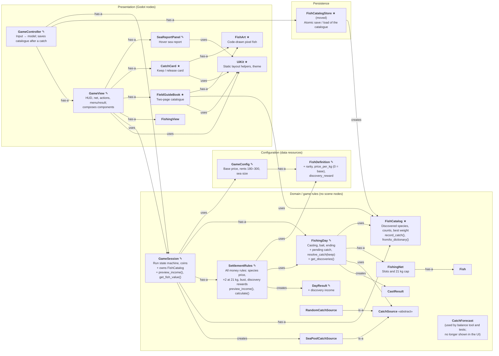

# Class Map — Stage 3 (`stage-3`)

Stage 3 adds a species economy, the keep-or-release choice and a persistent fish catalogue. **New** classes are marked ★, **modified** ✎, everything else is unchanged from [Stage 2](class_map_stage_2.md).

Connector labels: **is-a**, **has-a**, **uses**, **creates**.

`FixedCatchSource` (test) is still a `CatchSource`. New test helpers: `KeepEveryCatch` (a player who keeps every catch) and `LegacyTestConfig` (Stage 1 fish and rents).

## Responsibilities that moved or appeared

| Responsibility | Stage 2 owner | Stage 3 owner | Why |
| --- | --- | --- | --- |
| Price of a fish | `SettlementRules` (one global price) | `SettlementRules` (species price or base price) | Money stays in one class; preview and settlement cannot disagree |
| Discovery reward | — | `SettlementRules`, from `FishingDay.get_discoveries()` | The day records *facts*; the rules turn facts into gold |
| Which species are discovered, counts, best weight | — | `FishCatalog` | Outlives a voyage and changes for different reasons than a day |
| Saving the catalogue | — | `FishCatalogStore` in `persistence/` | File I/O is infrastructure, not a game rule |
| The keep/release decision | — (forced keep) | `FishingDay.resolve_catch()` | Same object that owns the net and bait |
| Catch card, field guide | — | `CatchCard`, `FieldGuideBook` | Keeps `GameView` from becoming a god class |
