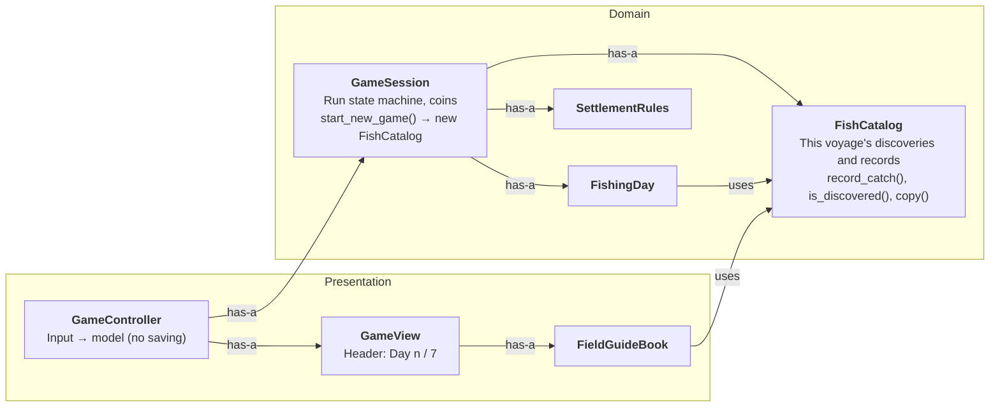

# Fixes after Stage 3

Changes made on `main` after the `stage-3` tag. The tags `stage-1`, `stage-2` and `stage-3` are unchanged; they record each stage as it was frozen. These fixes come from playtesting the Stage 3 build.

| # | Problem found in playtest | Change | Stages affected |
| --- | --- | --- | --- |
| 1 | The header showed only "Day 1", so players could not tell how far the seven-day voyage had progressed | Header shows **"Day n / 7"** (current day / total days from the config) | Stage 3 header. Stages 1–2 already showed "Day n / 7" |
| 2 | The field guide carried over between voyages, so a new voyage started with species already discovered and no discovery rewards left to earn | The field guide belongs to **one voyage**: starting or restarting a voyage empties it, and discovery rewards can be earned again. The catalogue is no longer saved to disk | Stage 3 only |

## Design impact

- `GameSession.start_new_game()` creates a new `FishCatalog` after the configuration is validated, so a failed restart still keeps the current voyage intact. `set_catalog()` was removed.
- `FishCatalog` lost its save-format code (`from_dictionary()`, version-1 migration, `SCHEMA_VERSION`). It keeps one responsibility: this voyage's discoveries and records.
- **Deleted:** `persistence/fish_catalog_store.gd` (`FishCatalogStore`). Nothing is saved, so keeping it would be dead code.
- `GameController` no longer loads or saves the catalogue. `GameView` shows "Day n / 7" and updated in-game wording ("once per voyage").
- **Unchanged:** `FishingDay`, `SettlementRules`, every `CatchSource`, `FishingNet`, `Fish`, `CastResult`, `CatchCard`, `FieldGuideBook` (except one line of text), `SeaReportPanel`.

The change stayed local because the catalogue was already one object owned by the session. Resetting it is one line in `GameSession`. Discovery rewards are still priced only by `SettlementRules`, so the money rules did not change.

Balance: the rent calibration in [catch choices](catch_choices.md) already simulated every voyage as a new save, so the rents need no change.

Tests: 10 suites, 1535 checks. The store and legacy-save checks were replaced by checks that the guide starts empty, that a new voyage resets it and pays discovery rewards again, and that the header reads "Day 1 / 7" then "Day 2 / 7".

## Final class map

Same as the [Stage 3 Class Map](class_map_stage_3.md), except for the parts below. This diagram shows only the classes around the change.

Removed from the Stage 3 map: the **Persistence** group (`FishCatalogStore`) and the links `GameController has-a FishCatalogStore` and `FishCatalogStore creates FishCatalog`.
